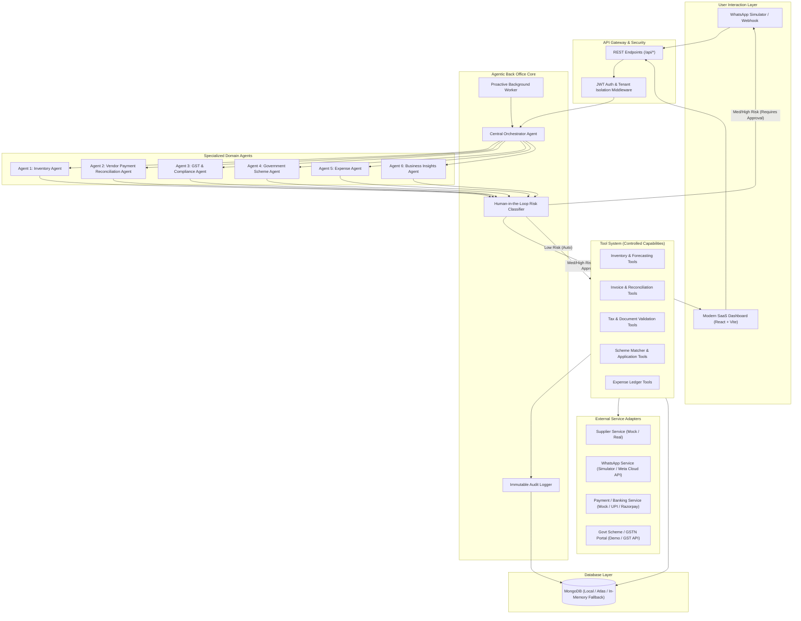
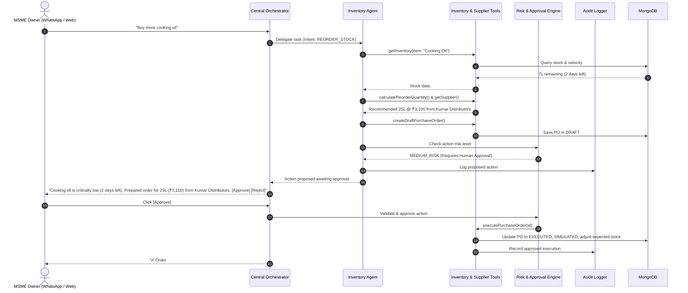

# Technical Implementation Plan: VyaparAI — Agentic Back Office for Indian MSMEs

VyaparAI is an autonomous, multi-agent AI back office designed specifically for Indian micro, small, and medium enterprises (MSMEs). Rather than passively presenting data on dashboards, VyaparAI proactively observes business operations, plans workflows, invokes domain-specific tools, requests human approval for medium/high-risk decisions, and autonomously executes tasks across inventory, payments, compliance, schemes, and expenses.

---

## 1. System Architecture & Flow



---

## 2. Monorepo Folder Structure

```text
VyaparAI/
├── package.json                    # Workspace root scripts
├── tsconfig.json                   # Base TS configuration
├── .env.example                    # Environment template
├── README.md                       # Comprehensive guide & architecture
├── backend/
│   ├── package.json
│   ├── tsconfig.json
│   ├── src/
│   │   ├── server.ts               # Express entrypoint
│   │   ├── config/                 # DB, Auth, and Environment config
│   │   ├── models/                 # Mongoose models (20 collections)
│   │   │   ├── Business.ts
│   │   │   ├── User.ts
│   │   │   ├── Product.ts
│   │   │   ├── Inventory.ts
│   │   │   ├── Supplier.ts
│   │   │   ├── Invoice.ts
│   │   │   ├── Payment.ts
│   │   │   ├── Expense.ts
│   │   │   ├── ComplianceTask.ts
│   │   │   ├── GovernmentScheme.ts
│   │   │   ├── SchemeApplication.ts
│   │   │   ├── PurchaseOrder.ts
│   │   │   ├── Approval.ts
│   │   │   ├── AgentTask.ts
│   │   │   ├── AgentRun.ts
│   │   │   ├── AgentAction.ts
│   │   │   ├── AuditLog.ts
│   │   │   ├── Notification.ts
│   │   │   ├── Conversation.ts
│   │   │   └── Message.ts
│   │   ├── middleware/             # Auth, Tenant isolation, Validation
│   │   ├── controllers/            # REST API route handlers
│   │   ├── routes/                 # Express routers
│   │   ├── services/               # Core business services & external adapters
│   │   │   ├── supplierService.ts  # ISupplierService (Mock & Real)
│   │   │   ├── whatsappService.ts  # IWhatsAppService (Simulator & Real)
│   │   │   ├── paymentService.ts   # IPaymentService
│   │   │   └── gstService.ts       # IGSTService
│   │   ├── agents/                 # Agent definitions & orchestrator
│   │   │   ├── orchestrator.ts     # Intent routing, chaining, synthesis
│   │   │   ├── inventoryAgent.ts   # Stockout forecasting, PO generation
│   │   │   ├── paymentAgent.ts     # Reconciliation, partial/dup detection
│   │   │   ├── complianceAgent.ts  # GST deadlines, doc prep
│   │   │   ├── schemeAgent.ts      # Eligibility matching, draft apps
│   │   │   ├── expenseAgent.ts     # Parsing & categorization
│   │   │   └── insightsAgent.ts    # Trend & anomaly detection
│   │   ├── tools/                  # Controlled agent tool implementations
│   │   │   ├── inventoryTools.ts
│   │   │   ├── paymentTools.ts
│   │   │   ├── complianceTools.ts
│   │   │   ├── schemeTools.ts
│   │   │   └── expenseTools.ts
│   │   ├── scheduler/              # Proactive background cron jobs
│   │   │   └── proactiveWorker.ts
│   │   └── seed/                   # Realistic "Shree General Store" demo data
│   │       └── seedData.ts
└── frontend/
    ├── package.json
    ├── vite.config.ts
    ├── tailwind.config.js
    ├── index.html
    └── src/
        ├── App.tsx
        ├── main.tsx
        ├── index.css
        ├── api/                    # Axios / Fetch client wrappers
        ├── context/                # Auth, Business, and Notification Contexts
        ├── components/
        │   ├── common/             # Navbar, Sidebar, Badges, Modals
        │   ├── whatsapp/           # WhatsApp Web simulator with interactive cards
        │   ├── dashboard/          # Attention-first executive dashboard
        │   ├── inventory/          # Stock table, velocity, reorder triggers
        │   ├── suppliers/          # Supplier list, lead times, order history
        │   ├── payments/           # Invoices, ledger, reconciliation modal
        │   ├── compliance/         # GST checklist, countdowns, form drafts
        │   ├── schemes/            # Scheme matcher, eligibility badges
        │   ├── approvals/          # Action cards (Approve / Reject / Modify)
        │   ├── activity/           # Visual agent reasoning & tool execution trace
        │   ├── audit/              # Immutable audit trail table
        │   └── settings/           # Business profile & AI thresholds
        └── types/                  # TypeScript interface definitions
```

---

## 3. Database Schema Design (MongoDB)

All schemas strictly enforce multi-tenant isolation via mandatory `businessId: ObjectId`.

1. **`Business`**: Name, Type (`Kirana`, `Manufacturing`, `Wholesale`, etc.), GSTIN, PAN, Address, Contact, Turnover, EmployeeCount, RegistrationDate, Settings (Auto-action thresholds, AI risk limits).
2. **`User`**: BusinessId, Name, Email, PasswordHash, Phone, Role (`OWNER`, `MANAGER`, `ACCOUNTANT`), IsDemoUser.
3. **`Product`**: BusinessId, Name, Category, SKU, HSNCode, Unit (`kg`, `L`, `pcs`, `box`), BasePrice, TaxRate (GST %).
4. **`Inventory`**: ProductId, BusinessId, CurrentStock, SafetyStockThreshold, AvgDailySales, StockVelocity, EstimatedDaysLeft, StockStatus (`HEALTHY`, `LOW`, `CRITICAL`), PreferredSupplierId.
5. **`Supplier`**: BusinessId, Name, ContactPerson, Phone, Email, GSTIN, Address, ProductsOffered, PaymentTermsDays, OutstandingBalance, AvgDeliveryLeadDays.
6. **`Invoice`**: BusinessId, SupplierId / CustomerId, Type (`PURCHASE`, `SALE`), InvoiceNumber, InvoiceDate, DueDate, Amount, PaidAmount, TaxAmount, Status (`UNPAID`, `PARTIALLY_PAID`, `PAID`, `OVERDUE`), LineItems.
7. **`Payment`**: BusinessId, InvoiceId, SupplierId, Amount, PaymentDate, PaymentMode (`UPI`, `NEFT`, `CASH`, `CHEQUE`), ReferenceNumber, Status (`COMPLETED`, `PENDING`, `DISPUTED`).
8. **`Expense`**: BusinessId, Category (`Transportation`, `Utilities`, `Rent`, `Packaging`, `Misc`), Amount, Description, Date, ReceiptUrl, AutoCategorized (boolean), ConfidenceScore.
9. **`ComplianceTask`**: BusinessId, Title (e.g. `GSTR-3B Monthly Return`), Category (`GST`, `INCOME_TAX`, `LABOUR`), DueDate, Status (`UPCOMING`, `IN_PROGRESS`, `PENDING_REVIEW`, `SUBMITTED`, `OVERDUE`), RequiredDocuments, PreparedData, ApprovedByOwner.
10. **`GovernmentScheme`**: Name, Ministry, Sector, MaxBenefit, SchemeCategory (`CREDIT_SUBSIDY`, `WORKING_CAPITAL`, `INFRASTRUCTURE`), EligibilityCriteria (Turnover, Category, MSME Type, Gender/Location preferences), RequiredDocuments, OfficialPortalUrl, IsDemoData (boolean).
11. **`SchemeApplication`**: BusinessId, SchemeId, MatchScore (0-100), Status (`DISCOVERED`, `DRAFT_PREPARED`, `DOCUMENTS_PENDING`, `READY_FOR_SUBMISSION`, `SUBMITTED`), PreFilledData.
12. **`PurchaseOrder`**: BusinessId, SupplierId, ProductId, Quantity, UnitPrice, TotalAmount, Status (`DRAFT`, `PENDING_APPROVAL`, `APPROVED`, `EXECUTED_SIMULATED`, `CANCELLED`), TriggerReason (`AGENT_PREDICTION`, `MANUAL`).
13. **`Approval`**: BusinessId, AgentName, ActionType (`CREATE_PURCHASE_ORDER`, `RECONCILE_PAYMENT`, `PREPARE_GST_DRAFT`, `DISBURSE_PAYMENT`), RiskLevel (`LOW`, `MEDIUM`, `HIGH`), Payload, Summary, Status (`PENDING`, `APPROVED`, `REJECTED`, `MODIFIED`), RespondedAt.
14. **`AgentTask` / `AgentRun` / `AgentAction`**: Granular execution tracking: Task ID, Agent ID, Step, ToolName, InputPayload, OutputPayload, ExecutionDurationMs, Status.
15. **`AuditLog`**: Immutable ledger of all state mutations performed by human or AI. Contains BusinessId, UserId, AgentName, ActionType, ResourceType, ResourceId, Diff/Payload, Timestamp.
16. **`Conversation` & `Message`**: Conversational session history for WhatsApp Simulator and Web Assistant, supporting message type (`text`, `action_card`, `approval_card`, `media`).

---

## 4. Agent & Tool Architecture

Every agent follows the **Observe $\to$ Plan $\to$ Tool Select $\to$ Execute $\to$ Verify $\to$ Human Gate** loop:



### Agent Tool Directory:
1. **Inventory Tools**:
   - `getInventory(productId, query)`
   - `calculateStockVelocity(productId)`
   - `predictStockoutDays(productId)`
   - `getPreferredSupplier(productId)`
   - `calculateReorderQuantity(productId)`
   - `createDraftPurchaseOrder(supplierId, items)`
   - `executePurchaseOrder(orderId)`
2. **Payment & Reconciliation Tools**:
   - `getInvoices(filters)`
   - `getPayments(filters)`
   - `reconcileInvoicesAndPayments()`
   - `detectPartialAndDuplicatePayments()`
   - `flagOverduePayments()`
   - `generateReconciliationReport()`
3. **GST & Compliance Tools**:
   - `getUpcomingDeadlines(daysAhead)`
   - `auditInvoicesForGSTCompliance()`
   - `checkMissingDocuments(taskId)`
   - `prepareGSTSummaryData(period)`
4. **Scheme Tools**:
   - `getBusinessProfile()`
   - `searchEligibleSchemes(profile)`
   - `calculateMatchPercentage(schemeId, profile)`
   - `generateApplicationChecklist(schemeId)`
   - `createDraftApplication(schemeId)`
5. **Expense Tools**:
   - `parseExpenseString(text)` (e.g. "Petrol 2000")
   - `categorizeExpense(description, amount)`
   - `recordExpense(data)`
   - `summarizeExpenses(period)`

---

## 5. Mock vs Real Integrations (Dual-Mode Interface)

To ensure the system works reliably out of the box without external API keys while maintaining production architecture:

| Service Area | Interface | Real Adapter | Mock / Demo Adapter (Default) |
|---|---|---|---|
| **AI LLM Engine** | `IAIEngine` | Gemini 1.5/2.0 API or OpenAI | Rule-based semantic parser + template engine with full agent reasoning trace |
| **WhatsApp Integration** | `IWhatsAppService` | Meta Cloud WhatsApp Business API Webhook | In-app Interactive WhatsApp Web Simulator with instant bi-directional messaging |
| **Suppliers** | `ISupplierService` | Supplier REST/EDI API | Simulated Supplier Gateway (lead-time simulation, mock ACK) |
| **Payment Gateway** | `IPaymentService` | Razorpay / Cashfree UPI API | Simulated UPI & NEFT payment verification engine |
| **GST / Government** | `IGSTService` | GST Suvidha Provider (GSP) API | Realistic GSTN Sandbox simulator with GSTR-1 & GSTR-3B draft builders |
| **Database** | `Mongoose` | Local MongoDB or MongoDB Atlas URI | Automatic fallback to `mongodb-memory-server` if local MongoDB daemon is not detected |

---

## 6. Security & Multi-Tenancy Architecture

1. **Tenant Isolation**: Every database query is scoped to `req.user.businessId`. Cross-tenant data leaks are prevented via strict Mongoose middleware.
2. **JWT Authentication & Password Hashing**: Passwords hashed with bcrypt; signed JWT tokens in HTTP headers.
3. **Role-Based Access Control (RBAC)**: `OWNER` can approve financial & compliance tasks; `MANAGER`/`STAFF` can create drafts.
4. **Approval Authorization Gate**: Autonomous agents cannot directly trigger state changes on financial or compliance actions without a cryptographic approval record.
5. **Input Sanitization**: Strong validation using zod/express-validator.
6. **No Leaked Secrets**: All API keys, secrets, and URLs isolated to `.env`.

---

## 7. Development Phases

- **Phase 1: Project Architecture & Setup** (Monorepo, backend/frontend initialization, TypeScript configs, environment files, base server & Vite setup).
- **Phase 2: Authentication & Business Profile** (JWT Auth, signup/login, multi-tenant middleware, business settings).
- **Phase 3: MongoDB Models & Seed Data** (20 collections, realistic "Shree General Store" seed dataset).
- **Phase 4: SaaS Dashboard & UI Foundation** (Executive Attention Dashboard, Navigation, Tailwind UI system).
- **Phase 5: Orchestrator Agent & Intent Routing** (Intent classifier, multi-agent router, chaining logic).
- **Phase 6: Inventory Agent & Stockout Forecasting** (Tools, stock velocity algorithms, PO generator).
- **Phase 7: Payment Reconciliation Agent** (Invoice-payment matching, partial/duplicate detection).
- **Phase 8: GST & Compliance Agent** (Deadlines, invoice audit, draft return generator).
- **Phase 9: Government Scheme Agent** (MSME scheme repository, eligibility scoring, application drafts).
- **Phase 10: Human-in-the-Loop Approval Center** (Risk tiers, approval workflow, action execution).
- **Phase 11: WhatsApp Simulator** (Realistic WhatsApp Web UI with interactive action buttons and chat bubbles).
- **Phase 12: Proactive Background Scheduler** (Periodic stock, payment, and tax monitoring cron).
- **Phase 13: Audit Logs & Observability** (Agent activity visualization, step-by-step reasoning logs).
- **Phase 14: Comprehensive Verification & Testing** (Unit tests, integration tests, end-to-end demo flows).
- **Phase 15: Documentation & Demo Polish** (Comprehensive README, quickstart scripts, demo guide).

---

## 8. Verification Plan

### Automated Tests:
- Run backend unit tests (`npm test` in backend) covering:
  - Inventory velocity and stockout calculation
  - Payment matching and discrepancy detection
  - GST deadline computation
  - Scheme eligibility scoring
  - Multi-tenant query isolation
- Run frontend build verification (`npm run build`).

### End-to-End Demo Scenario Verification:
1. **Scenario 1 (Inventory)**: Ask "Check my inventory" -> Agent detects low cooking oil -> Predicts 2 days left -> Drafts PO -> User clicks [Approve] -> Order executed and stock updated.
2. **Scenario 2 (Payments)**: Ask "Check supplier payments" -> Flags pending, partial (ABC Traders), and unmatched invoices.
3. **Scenario 3 (Compliance)**: Ask "What compliance tasks are pending?" -> Returns upcoming GSTR-3B with missing invoice alerts.
4. **Scenario 4 (Schemes)**: Ask "Find schemes for my business" -> Returns matched MSME schemes with eligibility breakdown.
5. **Scenario 5 (Overview)**: Ask "How is my business doing?" -> Returns consolidated health snapshot across all business pillars.
